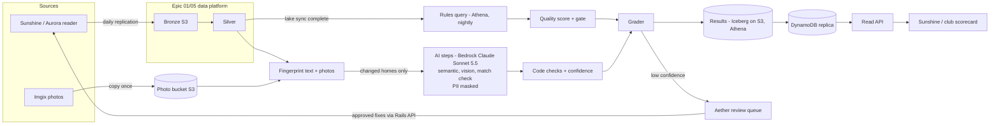

# scoring-grading

Property data-quality scoring (Part A) and product grading (Part B) for the vacation-home business.
Design: "Property Scoring and Grading: Approach" (v0.4) and "Property Scoring and Grading: Design" (v0.1).
Jira epic: QDEV-518, label `scoring-grading`.

> This repository is public. Never commit secrets, account credentials, `.env`, `db_connect.sh`,
> `docs/db_details/`, `data/` or any database extract. `.gitignore` excludes them; keep it that way.

## Status (2026-11-24)

Infra stories (dev account only; the prod account does not exist yet):

| Story | State |
|---|---|
| QDEV-890 IaC and CI skeleton | Dev pipeline works (checks, plan, apply). Promotion workflows and `stage`/`prod` protection in place. Prod approval untested until the prod account exists. |
| QDEV-889 Photo bucket | Deployed in dev and checked. "AI role can read" waits for the role in QDEV-888. |
| QDEV-888 Bedrock access | Blocked: Anthropic models fail in the dev account (use case form not submitted, Claude 5.x not enabled), quota is 0. Region: `us-west-2`. |

Open items:
- Dev bootstrap re-apply: apply role was widened for the Datadog forwarder (SG-I5). Bootstrap is applied by hand, so the change is not live in AWS until then.
- Datadog (SG-I5): integration role must be named `scoring-grading-<env>-datadog-integration` and the forwarder CloudFormation stack `scoring-grading-<env>-datadog-forwarder`, to fit the apply role scope. Datadog API/app keys go in GitHub Environment secrets only.
- Real `cost_centre` value (tags say `TBD`).
- PR `dev` -> `stage` is open and deliberately not merged yet.
- Prod account: bootstrap it, then set `AWS_ACCOUNT_ID` on the `prod` and `prod-plan` GitHub Environments.
- Scoring role for Bedrock (QDEV-888) once model access works.

## Logical architecture

From the Design doc, section 3. Rules run as one set-based query; the AI only sees homes whose text
or photos changed. Sunshine stays the system of record.



## Infrastructure (Terraform)

Account IDs are never committed. Pass them with `TF_VAR_account_id` (GitHub Environment variable in CI);
the provider refuses to run against any other account.

| Path | Purpose |
|---|---|
| `infra/terraform/bootstrap/` | One-time per account, applied by a human: state bucket, GitHub OIDC provider, deploy roles. Local state (gitignored). |
| `infra/terraform/modules/github_deploy_roles/` | OIDC plan role (read-only) and apply role. Apply role allows S3, IAM, KMS, Lambda, Logs, Secrets Manager/SSM and CloudFormation, only on names starting `scoring-grading-<env>-` (Lambda, Logs, Secrets, SSM and CloudFormation added for the Datadog forwarder, SG-I5). |
| `infra/terraform/modules/photo_bucket/` | Photo bucket, KMS key, lifecycle, copy-job role, read policy. |
| `infra/terraform/live/dev`, `live/prod` | Per-environment roots; remote state in S3 with native lockfile. |
| `.github/workflows/terraform.yml` | PR: fmt, validate, test, plan. Push to `dev`: apply to dev. Push to `prod`: apply to prod behind approval. `stage`: plan only against prod. |

| `.github/workflows/dev-to-stage-pr.yml`, `stage-to-prod-pr.yml` | Push to `dev` opens/updates a PR into `stage`; push to `stage` opens/updates a PR into `prod`. Merging is manual. |

Branches: `dev` (default) -> `stage` -> `prod`. `stage` and `prod` are protected: changes only by PR, the `checks` job must pass, no force push or delete.
Promotion: merge the PR into `stage` (plan against prod), then the PR into `prod` (apply to prod after the `prod` environment reviewer approves). Region: `us-west-2`.
Every resource gets tags `project=scoring-grading`, `owner`, `environment`, `cost_centre`, `managed_by=terraform`
(`cost_centre` is still the placeholder `TBD`).

### AWS resources

Dev account only for now; the prod account does not exist yet.

| Resource | Name | Status (dev) | Story |
|---|---|---|---|
| IAM OIDC provider | `token.actions.githubusercontent.com` | Deployed | QDEV-890 |
| IAM role (plan, read-only) | `scoring-grading-dev-tf-plan` | Deployed | QDEV-890 |
| IAM role (apply) + inline policy | `scoring-grading-dev-tf-apply` | Deployed | QDEV-890 |
| S3 bucket (Terraform state, versioned, encrypted, private) | `scoring-grading-tfstate-dev-<account>` | Deployed | QDEV-890 |
| State access policies on both roles | `state-access` | Deployed | QDEV-890 |
| S3 photo bucket (SSE-KMS, versioned, private, TLS-only) | `scoring-grading-dev-photos-<account>` | Deployed | QDEV-889 |
| KMS key + alias | `alias/scoring-grading-dev-photos` | Deployed | QDEV-889 |
| S3 lifecycle (resized copies expire after 30 days) | on photo bucket | Deployed | QDEV-889 |
| IAM role (photo copy job, write-only) | `scoring-grading-dev-photo-copy-job` | Deployed | QDEV-889 |
| IAM policy (read photos, for the AI role) | `scoring-grading-dev-photos-read` | Deployed | QDEV-889 |
| Bedrock model access, quota, scoring role | Claude Sonnet 5.5 via `us.anthropic.claude-sonnet-5-5` | Blocked: Anthropic access not enabled for the account, quota 0 | QDEV-888 |

Planned from the Design doc, not started: compute for rules and AI jobs (QDEV-891), observability and cost
alerts (QDEV-892), Iceberg results tables in Glue/Athena with Lake Formation (QDEV-893), DynamoDB replica and
read API (QDEV-894), event trigger on lake-sync completion (QDEV-895).

### Photo key layout

`original/<home_id>/<sha256>.<ext>` and `resized/<home_id>/<sha256>_<width>.<ext>`.
Builder and validation: `grade/photo_keys.py`. The lifecycle rule relies on the fixed `resized/` prefix.

### Local use

```bash
export AWS_PROFILE=<profile> TF_VAR_account_id=<12-digit dev account>
cd infra/terraform/live/dev
terraform init -backend-config="bucket=scoring-grading-tfstate-dev-$TF_VAR_account_id" -backend-config="region=us-west-2"
terraform plan
```

Tests: `terraform test` in `infra/terraform/modules/photo_bucket`; `pytest` for the Python packages.
